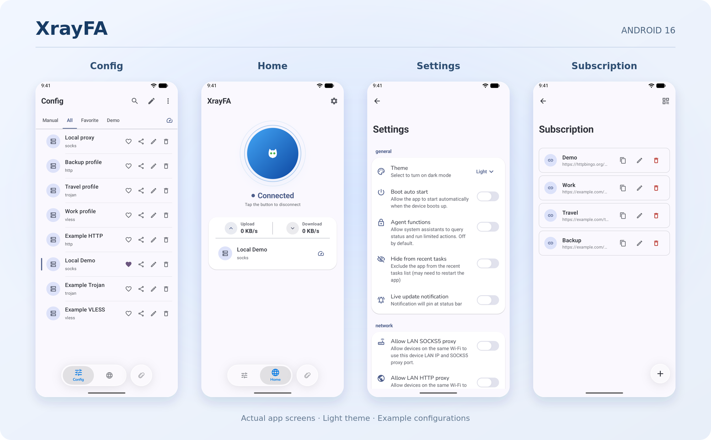

<div align="center">


# XrayFA

An open-source proxy client built on [Xray-core](https://github.com/XTLS/Xray-core), sharing Android and iOS UI and business logic through Kotlin Multiplatform.

**Android downloads are available; iOS has not been officially released.**

[Download for Android](https://github.com/Q7DF1/XrayFA/releases) · [F-Droid](https://f-droid.org/packages/com.android.xrayfa/) · [Report an issue](https://github.com/Q7DF1/XrayFA/issues)

English · [简体中文](README_zh-CN.md) · [Русский](README_RU.md) · [한국어](README_KR.md)

</div>

## Platform support

| Platform | System version | Availability |
|---|---|---|
| Android | Android 9.0 (API 28) and later | Downloads available |
| iOS | — | Not officially released |

Android uses `targetSdk 36` and `compileSdk 37`. No upper OS version limit is configured; minimum and target SDK values do not mean every OS version has been fully tested.

Android builds support `arm64-v8a`, `armeabi-v7a`, `x86_64`, and `x86`, with universal APK builds also available.

Android 9 has passed emulator smoke tests and manual runtime verification. Liquid Glass effects require Android 13 (API 33) or later; older versions use a compatible appearance.

## Features

- **Nodes and subscriptions**: Import node links; add, manage, and update subscriptions.
- **Multiple protocols**: VLESS, VMess, Shadowsocks, Trojan, Hysteria2, SOCKS, and HTTP proxy links.
- **Import options**: Clipboard, QR codes, and complete Xray JSON configurations.
- **Connection and traffic display**: VPN status and upload/download speeds.
- **Routing and DNS**: Configure routing, DNS, and related network options.
- **Node sharing**: Share ordinary nodes as links or QR codes.
- **UI and themes**: Shared Compose Multiplatform UI, dark mode, and large-screen layouts.
- **Android integration**: Per-app proxy settings, log viewing, and other platform features.

Supported protocols, transports, and configuration fields depend on the current parsers and the Xray-core version used by this repository.

## Screenshots

Captured on Android 16 with a 20:9 phone aspect ratio, light theme, and example configurations. The pages are Config, Home, Settings, and Subscription.

[](docs/assets/android-overview.png)

[View full screenshots](docs/screenshots.md)

## Download and usage

### Android

- [GitHub Releases](https://github.com/Q7DF1/XrayFA/releases)
- [F-Droid](https://f-droid.org/packages/com.android.xrayfa/)

Choose a universal APK if you are unsure of your device architecture. Packages from different channels may use different signing keys; switching channels may require reinstalling. Save your configurations first.

### iOS

Not officially released. Building from source is currently the available option.

### Quick start

1. Install the app and import node links or add a subscription.
2. Select a node from the configuration list.
3. Start the connection on Home and allow the system VPN permission request.
4. Check status and traffic; adjust routing and DNS as needed.

Complete Xray JSON configurations have limitations for node-link sharing, latency tests, and some traffic statistics.

## Architecture and build system

XrayFA uses Gradle Kotlin DSL and a version catalog for dependencies. Android and iOS share the main UI and business logic, with platform-specific VPN services and native integrations.

| Layer | Technology |
|---|---|
| Shared language and logic | Kotlin Multiplatform |
| Shared UI | Compose Multiplatform, Material 3 |
| Navigation and state | Decompose, Essenty |
| Dependency injection | Koin |
| Storage | Room Multiplatform, DataStore |
| Networking and serialization | Ktor, kotlinx.serialization |
| Proxy core | Xray-core, AndroidLibXrayLite |
| TUN forwarding | hev-socks5-tunnel |
| Android host | Android app, VpnService, JNI |
| iOS host | SwiftUI, UIKit, Network Extension |

### Directory structure

```text
XrayFA/
├── androidApp/          Android app and platform integration
├── iosApp/              iOS app and PacketTunnel extension
├── shared/              Shared UI, navigation, and components
├── common/              Common types and utilities
├── domain/              Protocol parsing and configuration models
├── core/
│   ├── data/            Repositories
│   ├── database/        Room database
│   ├── datastore/       Settings storage
│   ├── network/         Networking
│   └── native-bridge/   Xray native bridge
├── platform/vpn/        Platform VPN interfaces and implementations
├── AndroidLibXrayLite/  Go native library submodule
├── tun2socks/           TUN forwarding and Android JNI
├── scripts/             Native library and build preparation
└── gradle/              Wrapper and dependency version catalog
```

## Build from source

### Get the source

```bash
git clone --recursive https://github.com/Q7DF1/XrayFA.git
cd XrayFA
```

For an existing clone:

```bash
git submodule update --init --recursive
```

### Android

Requirements:

- JDK 17, matching Android CI; Java/JVM bytecode targets version 11.
- Android SDK Platform 37, Platform Tools, and the corresponding Build Tools.
- Android NDK `28.2.13676358`.
- Go: the native submodule declares `go 1.26`; build configuration records `GO_VERSION=1.27.1`.
- Git; repository scripts also require Bash and curl or wget.
- Android Studio can be used for project sync, running, and debugging.

Configure the Android SDK path and use the required NDK. The first build downloads Gradle, dependencies, Go tools, and routing data.

Prepare routing data and the native Xray AAR:

```bash
bash scripts/fdroid.sh prebuild
bash scripts/fdroid.sh bind
```

Build the app:

```bash
# Debug
./gradlew :androidApp:assembleDebug

# Release
./gradlew :androidApp:assembleRelease
```

Output directories:

```text
androidApp/build/outputs/apk/debug/
androidApp/build/outputs/apk/release/
```

Native preparation generates `androidApp/libs/libv2ray.aar`. The ordinary `preBuild` task does not compile this AAR automatically.

Release builds enable code and resource shrinking. To sign a release, provide `androidApp/xrayfa.jks` and these environment variables:

```text
KEYSTORE_PASSWORD
KEY_ALIAS
KEY_PASSWORD
```

Without a keystore, the release APK is unsigned and must be signed before installation. Evaluate performance with Release; Debug includes debugging overhead and LeakCanary.

Linux and Windows skip iOS targets by default; macOS enables them. To explicitly build Android only:

```bash
./gradlew :androidApp:assembleDebug -PenableIosTargets=false
```

### iOS

Requirements:

- macOS; the current shared UI simulator build uses an Apple Silicon Mac.
- Xcode 26 or later and the corresponding iOS SDK.
- JDK 17, Go, gomobile, gobind, and XcodeGen.
- Signing, Network Extension, and App Group configuration for physical devices.

Install and initialize the Go mobile tools:

```bash
go install golang.org/x/mobile/cmd/gomobile@latest
go install golang.org/x/mobile/cmd/gobind@latest
export PATH="$PATH:$(go env GOPATH)/bin"
gomobile init
```

Build native dependencies and generate the Xcode project:

```bash
./scripts/build_libxray_ios.sh
./scripts/build_hev_tun_ios.sh
./scripts/generate_ios_xcodeproj.sh
```

Build the shared framework for an Apple Silicon simulator:

```bash
./gradlew :shared:linkDebugFrameworkIosSimulatorArm64
```

Open `iosApp/iosApp.xcodeproj` in Xcode and run the `iosApp` scheme. Xcode build phases integrate Kotlin framework compilation.

See the [iOS build documentation](iosApp/README.md).

## Testing and feedback

Run Android/JVM unit tests:

```bash
./gradlew test -PenableIosTargets=false
```

Some modules require the native AAR before testing.

Include the app version, OS version, architecture, installation channel, and reproduction steps when reporting an issue. Remove subscription URLs and authentication details from logs and screenshots.

[Report an issue](https://github.com/Q7DF1/XrayFA/issues)

## Acknowledgements

- [Xray-core](https://github.com/XTLS/Xray-core)
- [AndroidLibXrayLite](https://github.com/2dust/AndroidLibXrayLite)
- [hev-socks5-tunnel](https://github.com/heiher/hev-socks5-tunnel)
- Kotlin Multiplatform, Compose Multiplatform, Decompose, Koin, and other open-source dependencies

## License

XrayFA uses the [Apache-2.0 license](LICENSE). Third-party dependencies retain their respective licenses.
