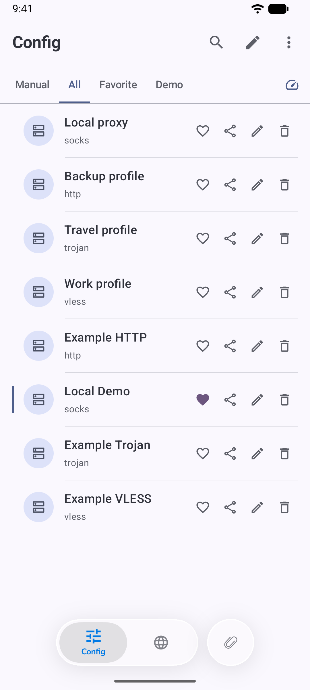
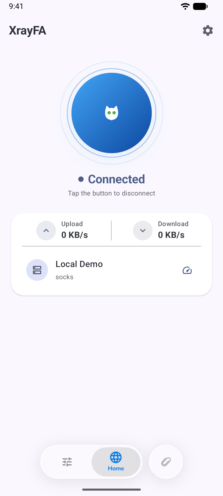
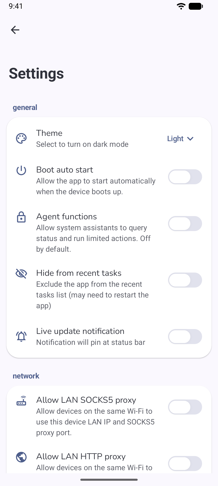
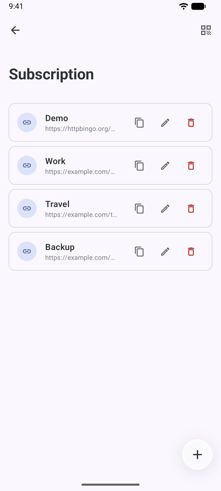

# XrayFA screenshots

Android 16 · 20:9 · Light theme · Example configurations.

Home shows an actual connection to a local test proxy. The nodes and subscription addresses shown here are demonstration data. Select a screenshot to open the full-resolution image.

| Config · 节点管理 | Home · 连接状态 |
|:---:|:---:|
|  |  |

| Settings · 设置 | Subscription · 订阅 |
|:---:|:---:|
|  |  |

[English](../README.md) · [简体中文](../README_zh-CN.md) · [Русский](../README_RU.md) · [한국어](../README_KR.md)
